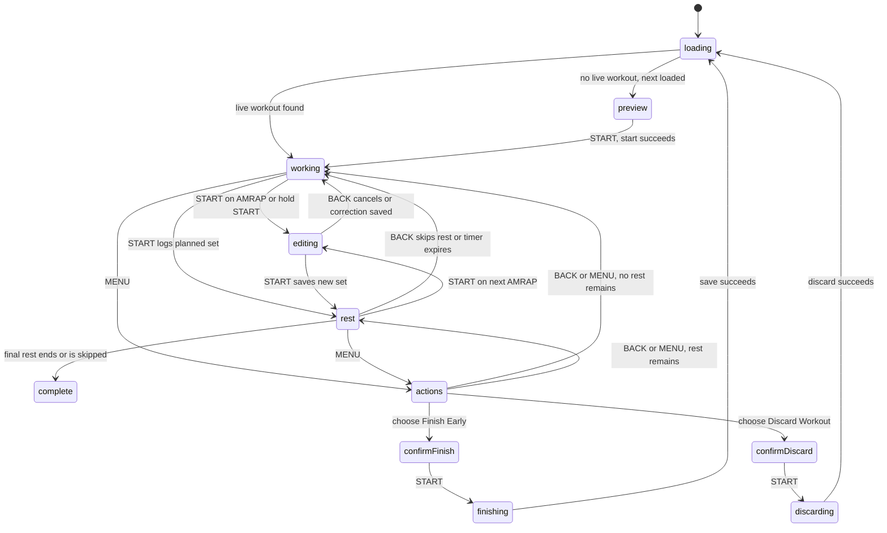

# Workout state machine

This describes the behavior currently implemented by `LiftosaurStore` and
`LiftosaurDelegate`. It is a description of the code today, including its
asynchronous API and timer transitions. It is not yet a centralized or pure
state machine.

## State model

`state["phase"]` is the current screen/workflow phase. The same dictionary also
holds workout data and workflow details such as the selected exercise and set,
the edit values, the rest deadline, queued API writes, and pending finish or
discard operations. The dictionary is saved in Connect IQ storage.

| Phase | Meaning |
| --- | --- |
| `loading` | Fetching the live workout, or fetching the next workout when none is live. |
| `preview` | The next workout is loaded and can be started on the watch. |
| `working` | Showing the selected set. It may be an incomplete set or a previously completed set being reviewed. |
| `editing` | Editing reps or weight for a set, or entering reps for an AMRAP set. |
| `rest` | A set has been logged and the rest countdown is running. The cursor points at the next set, if one exists. |
| `actions` | Workout menu with Finish Early and Discard Workout. |
| `confirm-finish` | Confirming that the workout should finish early. |
| `finishing` | Waiting for queued set writes, then saving the workout. Retries after a failed save. |
| `confirm-discard` | Confirming that the workout should be discarded. |
| `discarding` | Waiting for queued writes or sending the discard request. |
| `complete` | All sets are complete; Select finishes and saves the workout. |
| `error` | A blocking API or unsupported-workout error is displayed. |

`rest-done` is still mentioned in `select()`, but no current transition enters
that phase. Rest expiration transitions directly to `working` or `complete`.

## Inputs and transitions

`START` below means a short press. Holding START is recognized from raw key
events; the hold threshold is 700 ms.

| Current phase | Input | State/action |
| --- | --- | --- |
| `loading` | API current-workout response | If a live workout exists, adopt it and go to its saved active phase or `working`. If none exists, fetch next. |
| `loading` | API next-workout response with a workout | Save it and go to `preview`. |
| `preview` | START | Validate supported set types; send start request. On success go to `working`; otherwise go to `error`. |
| `working` | START on an incomplete planned set | Log a regular set and enter `rest`. On an AMRAP set, enter `editing`. A completed set stays selected and displays “Set already logged”. |
| `working` | Hold START | Enter `editing` for the selected set, including a previously completed set. |
| `working` | UP/DOWN | Move to the previous/next set. Navigation wraps across exercise boundaries. |
| `working` | BACK | Queue an undo of the most recently logged set and return the cursor to it. |
| `working` | MENU | Open `actions`. |
| `rest` | START on an upcoming AMRAP set | Skip the rest timer and enter `editing` for that AMRAP set. START otherwise has no action. |
| `rest` | BACK | Skip the rest timer and preserve the completed set. Go to `working`, or `complete` if it was the last set. |
| `rest` | MENU | Open `actions`; closing the menu returns to rest if time remains. |
| `rest` | Timer expires | Vibrate and go to `working`, or `complete` if no sets remain. |
| `editing` | UP/DOWN | Increase/decrease reps. Weight editing also supports weight adjustment where available. |
| `editing` | START | Save/log the edited set, or save a correction to an already logged set. A newly logged set enters `rest`. |
| `editing` | Hold START | Save/log the edited set. |
| `editing` | BACK | Cancel editing and return to `working`. |
| `editing` | MENU | No action. |
| `actions` | UP/DOWN | Select Finish Early or Discard Workout. |
| `actions` | START | Open the selected confirmation phase. |
| `actions` | BACK or MENU | Close the menu and return to the prior working/rest/complete phase as determined by the rest deadline and last-set flag. |
| `confirm-finish` | START | Wait for queued set writes, then send finish; success loads the next workout. |
| `confirm-finish` | BACK or MENU | Cancel and return to the prior workout phase. |
| `confirm-discard` | START | If a request is in flight, wait for that callback; then send discard. Success clears the workout and loads the next workout. |
| `confirm-discard` | BACK or MENU | Cancel and return to the prior workout phase. |
| `finishing` | API failure / retry timer | Keep the phase and retry the finish request. |
| `complete` | START | Finish and save the workout. |
| Active workout | Successful set API response | Adopt server workout, remove the acknowledged queue item, then send the next queued write if present. |
| Active workout | Failed set API response / retry timer | Keep queued action and retry after the configured delay. |

## Effects and persisted data

User input and callbacks currently call `LiftosaurStore` methods that update
state, save it, refresh the view, and sometimes start HTTP requests or timers.
Set writes are queued and persisted so they can be retried after a connection
failure or app restart. The rest timer is represented by an absolute `restEnd`
timestamp; the one-second timer refreshes the countdown and detects expiration.

API operations are `GET /workout/current`, `GET /workout/next`, `POST
/workout/start`, `POST /workout/set`, `POST /workout/finish`, and `DELETE
/workout/current`. Their callbacks can update both workout data and phase.

## Is this a state machine?

Yes, informally: the `phase` values are states, and button events, timer events,
and API callbacks cause transitions. `LiftosaurStore` is also more than a state
machine, though. It mixes transition rules with API calls, persistence, timer
management, cursor navigation, and view notifications. There is no single
transition table enforced by the implementation, and phase strings can be
assigned in many methods. That makes accidental or inconsistent transitions
harder to spot.

## Model View Update (MVU)

MVU fits this app well and does not require a Monkey C framework. A practical
shape would be:

1. **Model** — the full workout state: phase, workout, cursor, edit values,
   rest deadline, pending queue, and request status.
2. **Message** — a typed event such as `StartPressed`, `BackPressed`,
   `RestTick(now)`, `CurrentWorkoutLoaded(result)`, or `SetSaved(result)`.
3. **Update** — a mostly pure function that takes `(model, message)` and returns
   `(newModel, effects)`. It owns all phase transitions and ignores or rejects
   messages that do not apply in the current phase.
4. **Effects** — an outer runner performs HTTP, timers, vibration, and storage
   operations. Results return as new messages.
5. **View** — renders the model and sends button messages; it does not mutate
   workout state.

For example, `StartPressed` in `rest` could produce an effect-free transition
to `working`, or to `editing` when the upcoming set is AMRAP. A separate
`LogSet` message would update the local model and return a `SendSet` effect.

The first refactoring step should be to centralize transitions in an `update`
function while keeping the existing screen and API code. Then move effects
behind a small runner. This allows tests to exercise transition logic without
network access or a simulator UI.

## Unit testing with Monkey C

Garmin's Connect IQ SDK includes `Toybox.Test` and the Run No Evil unit-test
runner. Test functions use the `(:test)` annotation and a `Test.Logger`; the
SDK can compile tests with `--unit-test` and run them in the simulator using
`monkeydo ... /t`. The fēnix 5 target API level (3.1) supports this testing API.

There are no state-machine unit tests in the repository yet. The current store
is coupled to HTTP, time, storage, and timers, so useful transition tests would
be easier after separating a pure update function from those effects. Early
cases should cover:

- START on a planned set logs it; START on an AMRAP opens the editor.
- START on AMRAP during rest skips rest and opens the editor without undoing
  the preceding completed set.
- BACK during rest skips rest but preserves the completed set; BACK during
  working undoes the latest set.
- Timer expiration enters the correct next phase, including after the final
  set.
- A successful set response removes exactly one queue item; a failed response
  preserves it for retry.
- Finish and discard wait for queued writes and only clear the workout on
  success.

See Garmin's [unit testing guide](https://developer.garmin.com/connect-iq/core-topics/unit-testing/)
and [`Toybox.Test` reference](https://developer.garmin.com/connect-iq/api-docs/Toybox/Test.html).
