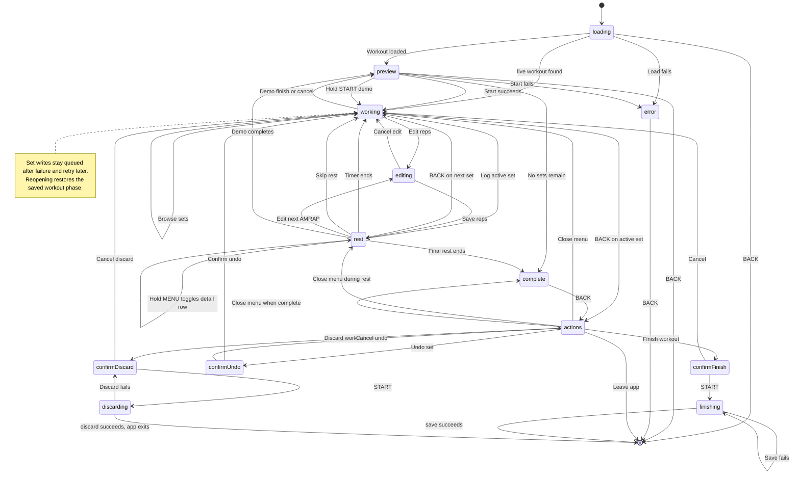

# Workout state machine

This describes the behavior implemented by `LiftosaurUpdate` and its runtime
adapter, `LiftosaurStore`. Button, rest-expiration, and API-result transitions
are handled by the reducer. The store parses responses and runs effects.

## State model

`state["phase"]` is the current screen/workflow phase. The same dictionary also
holds workout data and workflow details such as the selected exercise and set,
the active exercise, edit values, the rest deadline, queued API writes, and
pending finish or discard operations. Real workout state is saved in Connect IQ
storage; Demo mode state is intentionally RAM-only.

| Phase | Meaning |
| --- | --- |
| `loading` | Fetching the live workout, or fetching the next workout when none is live. |
| `preview` | The next workout is loaded and can be started on the watch. |
| `working` | Showing the selected set. Sets must be logged in order within an exercise; exercises can be done in any order. |
| `editing` | Editing reps or weight for a set, or entering reps for an AMRAP set. |
| `rest` | A set has been logged and the rest countdown is running. The cursor points at the next set, if one exists. |
| `actions` | Workout menu ordered Leave / Keep Workout, Finish Workout, Undo this/last set (when available), then Discard Workout. Leave / Keep is selected by default. |
| `confirm-undo` | Confirms clearing the selected completed set, or the most recently completed set if the cursor is on an incomplete set. |
| `confirm-finish` | Confirming that the workout should be finished and saved. |
| `finishing` | Waiting for queued set writes, then saving the workout. Retries after a failed save. |
| `confirm-discard` | Confirming that the workout should be discarded. |
| `discarding` | Waiting for queued writes or sending the discard request. |
| `complete` | No unfinished sets remain in the active exercise or later exercises. Earlier skipped exercises can still be revisited with UP/DOWN. START finishes and saves. |
| `error` | A blocking API or unsupported-workout error is displayed. |

Rest expiration transitions directly to `working` or `complete`.

## Inputs and transitions

`START` below means a short press. Holding START is recognized from raw key
events; the hold threshold is 700 ms.

Demo mode is a local-only flag over the workout phases. It starts from the
already downloaded preview with a hold of START, keeps set changes in memory,
and returns to that preview when the demo is canceled or finished. No workout
start, set, finish, or discard request is sent for a demo.

| Current phase | Input | State/action |
| --- | --- | --- |
| `loading` | API current-workout response | If a live workout exists, adopt it and go to its saved active phase or `working`. If none exists, fetch next. |
| `loading` | API next-workout response with a workout | Save it and go to `preview`. |
| `preview`, `loading`, or `error` | BACK | Exit the app. |
| `preview` | START | Validate supported set types; send start request. On success go to `working`; otherwise go to `error`. |
| `preview` | Hold START | Enter a RAM-only demo using the already downloaded workout. |
| Demo `working`, `rest`, or `editing` | Set actions | Keep logs, edits, and undo changes in memory only. |
| `working` | START on an incomplete planned set | Log a regular set and enter `rest`, recording the target reps for both sides on a unilateral set. On an AMRAP set, enter `editing`. A completed set stays selected and displays "Set already logged". |
| `working` | START on a later unfinished set in the same exercise | Do not log it; show "Complete earlier sets first". |
| `working` | Hold START | Enter `editing` for the selected set, including a previously completed set. On a unilateral set, edit left reps first. |
| `working` | Hold START on a later unfinished set in the same exercise | Do not open the editor; show "Complete earlier sets first". |
| `working` | UP/DOWN | Browse sets. Moving forward across an exercise boundary makes that exercise active, skipping its predecessor's remaining sets. Moving backward only browses; START on the first unfinished set of any exercise makes it active. Completed sets are green, the next set is blue, and future sets are light gray. |
| `working` | Hold DOWN | Jump to the next exercise and select its first set. |
| `working` | BACK while viewing a set other than the active exercise's next set | Return to that next set. |
| `working` | BACK on the active exercise's next set | Open `actions`. |
| `working` | Hold MENU | Toggle the extra row between estimated 1RM and plates per side. |
| `rest` | START on an upcoming AMRAP set | Skip the rest timer and enter `editing` for that AMRAP set. START otherwise has no action. |
| `rest` | UP/DOWN | Browse sets while the rest countdown continues. The arc remains visible; completed sets are green, the next set is blue, and future sets are light gray. |
| `rest` | Hold DOWN | Jump to the next exercise while the rest countdown continues. |
| `rest` | BACK while viewing another set | Return to the next set without canceling rest. |
| `rest` | BACK on the next set | Cancel rest and preserve the completed set. Go to `working`, or `complete` if it was the last set. |
| `rest` | Hold MENU | Toggle the extra row between estimated 1RM and plates per side while the timer continues. |
| `rest` | Timer expires | Vibrate and go to `working`, or `complete` if no sets remain. |
| `editing` | UP/DOWN | Increase/decrease the selected reps. Unilateral sets show both side counts together and highlight the active side. Weight editing also supports weight adjustment where available. |
| `editing` | START | On a unilateral set, move selection from left to right; START on the right saves/logs the set or correction. Other sets save/log immediately. A newly logged set enters `rest`. |
| `editing` | Hold START | Save/log the edited set. On unilateral sets, START advances from left reps to right reps before saving. |
| `editing` | BACK | Cancel editing and return to `working`. |
| `editing` | MENU | No action. |
| `actions` | UP/DOWN | Select Leave / Keep Workout, Finish Workout, Undo this/last set (if available), or Discard Workout, in that order. |
| `actions` | START | Open the selected confirmation phase, perform Undo after confirmation, or exit for Leave / Keep Workout. |
| Demo complete, Finish confirmation, or Discard confirmation | START | Finish or cancel the demo and return to the original preview. |
| `actions` | START on Leave / Keep Workout | Save the underlying working/rest/complete phase and exit the app without changing the server workout. |
| `actions` | BACK | Close the menu and return to the prior working/rest/complete phase as determined by the rest deadline and last-set flag. |
| `confirm-finish` | START | Wait for queued set writes, then send finish; success exits the app. |
| `confirm-finish` | BACK | Cancel and return to the prior workout phase. |
| `confirm-undo` | START | Clear the selected completed set, or the most recently completed set if the cursor is on an incomplete set. Send its `POST /workout/set` update with `completed: null`, then return the cursor to that set. |
| `confirm-undo` | BACK | Cancel and return to the workout menu. |
| `confirm-discard` | START | If a request is in flight, wait for that callback; then send discard. Success clears the workout and exits the app. |
| `confirm-discard` | BACK | Cancel and return to the prior workout phase. |
| `finishing` | API failure / retry timer | Keep the phase and retry the finish request. |
| `complete` | BACK | Open `actions`. |
| `complete` | START | Finish and save the workout. |
| `complete` | UP/DOWN | Reopen a set for review. Moving to an unfinished set resumes `working` from that exercise. |
| `complete` | Hold DOWN | Jump to the next exercise and resume `working`. |
| Active workout | Successful set API response | Adopt server workout, remove the acknowledged queue item, then send the next queued write if present. |
| Active workout | Failed set API response / retry timer | Keep queued action and retry after the configured delay. |

## Effects and persisted data

The reducer returns a new model and effects. The store persists it, refreshes
the view, and runs HTTP requests, timer control, and vibration effects. Set
writes are queued and persisted so they can be retried after a connection
failure or app restart. Exit / Keep Workout preserves the phase, rest deadline,
and queued writes, so reopening the app resumes the live workout. The rest timer is represented by an absolute `restEnd`
timestamp; the one-second timer refreshes the countdown and sends expiration to
the reducer.

API operations are `GET /workout/current`, `GET /workout/next`, `POST
/workout/start`, `POST /workout/set`, `POST /workout/finish`, and `DELETE
/workout/current`. Their callbacks can update both workout data and phase.

## Is this a state machine?

Yes. `LiftosaurUpdate.update(model, message, now)` handles button, menu,
navigation, timer-expiration, and current/next/start/set/finish/discard API
result messages. It returns a new model, a list of effects, and whether the
view should refresh. `LiftosaurStore` parses API responses, dispatches result
messages, persists and renders the returned model, then runs effects.

Phase and workout transitions are now reducer-owned, including local set logs,
corrections, undo, finish/discard initiation, and request status. The store
handles API parsing, persistence, timer/request busy flags, and external I/O.
It still compacts a previously saved workout on app open and reports a storage
write failure directly because those are adapter-level recovery paths.

## Model View Update (MVU)

MVU is implemented for watch inputs, rest-timer expiration, request status,
local set changes, and API results. The architecture for any remaining paths
is:

1. **Model** — the full workout state: phase, workout, cursor, edit values,
   rest deadline, pending queue, and request status.
2. **Message** — a typed event such as `StartPressed`, `BackPressed`,
   `RestTick(now)`, `CurrentWorkoutLoaded(result)`, or `SetSaved(result)`.
3. **Update** — a mostly pure function that takes `(model, message)` and returns
   `(newModel, effects)`. It owns all phase transitions and ignores or rejects
   messages that do not apply in the current phase.
4. **Effects** — an outer runner performs HTTP, timers, vibration, and storage
   operations. Results return as new messages.
5. **View** — renders the model and sends button messages; it does not mutate
   workout state.

For example, `StartPressed` in `rest` could produce an effect-free transition
to `working`, or to `editing` when the upcoming set is AMRAP. A separate
`LogSet` message would update the local model and return a `SendSet` effect.

Effects now perform external work only: network requests, timers, and
vibration. Reducer tests run without network access or simulator UI
interaction.

## Unit testing with Monkey C

Garmin's Connect IQ SDK includes `Toybox.Test` and the Run No Evil unit-test
runner. Test functions use the `(:test)` annotation and a `Test.Logger`; the
SDK can compile tests with `--unit-test` and run them in the simulator using
`monkeydo ... /t`. The fēnix 5 target API level (3.1) supports this testing API.

The repository has a simulator test suite in `source/LiftosaurUpdateTests.mc`.
Run it with `./run-tests.ps1` (or pass `-SdkPath`). Current tests cover:

- START on a planned set logs it; START on an AMRAP opens the editor.
- START on AMRAP during rest skips rest and opens the editor without undoing
  the preceding completed set.
- BACK during rest returns to the next set, then skips rest on a second press;
  BACK during working opens workout options.
- Timer expiration enters the correct next phase, including after the final
  set.
- A successful set response removes exactly one queue item; a failed response
  preserves it for retry.
- Successful finish clears the active workout and requests the next one;
  failed discard returns to its confirmation phase.
- Planned set logging, correction, undo, finish/discard initiation, and request
  status transitions are handled by the reducer.
- Undo from the workout menu chooses the selected completed set when possible,
  otherwise the latest completed set; confirmation, cancellation, queued
  clearing, and cursor restoration are covered by reducer tests.
- Rep adjustment stays inside the editing phase.

See Garmin's [unit testing guide](https://developer.garmin.com/connect-iq/core-topics/unit-testing/)
and [`Toybox.Test` reference](https://developer.garmin.com/connect-iq/api-docs/Toybox/Test.html).
